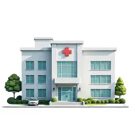
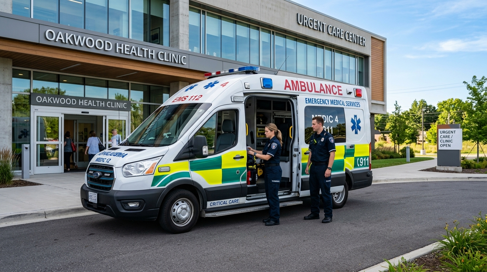
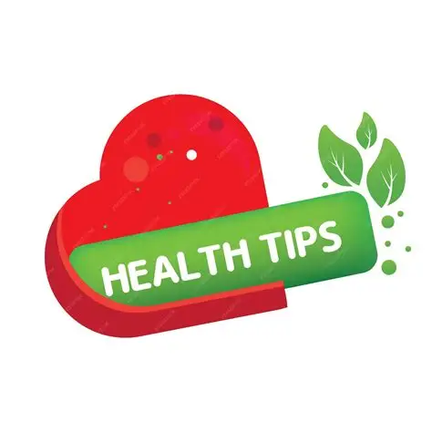
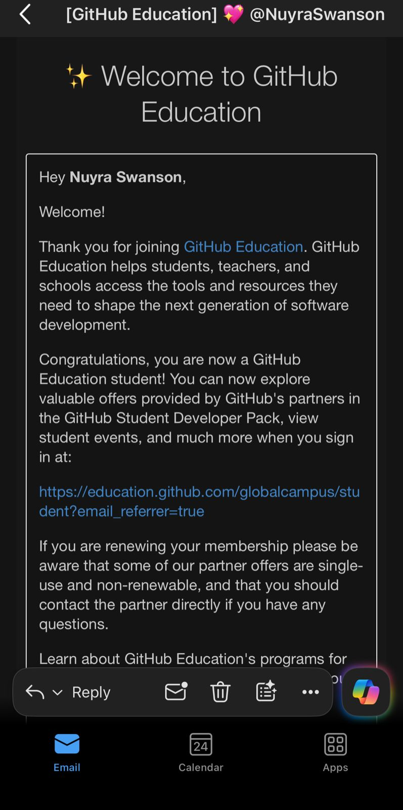

# Nuyra Swanson — Digital Portfolio & Portfolio of Evidence (PRP370S)

> **Cape Peninsula University of Technology (CPUT)**  
> **Faculty of Informatics and Design** | Department of Information & Communication Technology  
> **Subject**: Project Presentation 3 (`PRP370S` / `PRP371S` / `PRP372S`) — October 2026  
> **Examiner**: P Inderlal | **Internal Moderator**: W Hendricks | **External Moderator**: S Thakur  
> **Student Name**: Nuyra Swanson | **Student Number**: 221290524 | **Email**: 221290524@mycput.ac.za  

---

## 📑 Portfolio Navigation

- [Professional Profile & Contact](#professional-profile)
- [Flagship Project: CareConnect PWA](#flagship-project-careconnect-patient-queue--emergency-app)
- [Project Screenshots & UI Artefacts](#project-screenshots--ui-artefacts)
- [GitHub Portfolio Assessment Rubric (100 Marks)](#github-portfolio-rubric-evidence--reflections-100-marks)
  - [1. Agile Team Charter (20 Marks)](#1-agile-team-charter-20-marks)
  - [2. User Stories and Tasks (20 Marks)](#2-user-stories-and-tasks-20-marks)
  - [3. Product Backlog (20 Marks)](#3-product-backlog-20-marks)
  - [4. Sprint Backlog (20 Marks)](#4-sprint-backlog-20-marks)
  - [5. Agile Logbook & Retrospective (20 Marks)](#5-agile-logbook--daily-stand-ups-20-marks)
- [Academic & Personal Software Projects](#academic-and-personal-projects)
- [Technical Skills & Architecture Matrix](#technical-skills)
- [Education Timeline](#education)
- [Mock Interview Video & Reflections](#mock-interview-video)
- [GitHub Student Developer Pack Evidence](#github-student-account-evidence)

---

## Professional Profile

Innovative ICT: Application Development student at the Cape Peninsula University of Technology (CPUT) with a strong foundation in Java enterprise systems, database integration (JDBC, MySQL, Supabase PostgreSQL), client-server architectures, and modern front-end web engineering (HTML5, CSS3, JavaScript ES6+). Certified in application security concepts and core IT infrastructure.

Passionate about building secure, accessible, community-impactful software solutions and contributing to collaborative, quality-driven development teams.

- 📍 **Location**: Cape Town, South Africa
- 📧 **Email**: [221290524@mycput.ac.za](mailto:221290524@mycput.ac.za)
- 📱 **Mobile**: [+27 65 821 1952](tel:+27658211952)
- 🐙 **GitHub Profile**: [https://github.com/NuyraSwanson](https://github.com/NuyraSwanson)
- 📄 **Curriculum Vitae**: [Download CV Document (DOCX)](CV_Nuyra_Swanson%202026.docx)

---

## Flagship Project: CareConnect Patient Queue & Emergency App

- **Repository**: [https://github.com/PamMasina/CareConnect.git](https://github.com/PamMasina/CareConnect.git)
- **Live Deployment**: [https://care-connect-delta-puce.vercel.app/](https://care-connect-delta-puce.vercel.app/)
- **Group Members & Roles**:
  1. **Siphelele Zono** — Scrum Master & Agile Facilitator
  2. **Sinalo Kebetwana** — Product Owner & Requirements Lead
  3. **Nuyra Swanson** — Full-Stack Developer (Auth, Appointment Booking & Emergency SOS Lead)
  4. **Andile Pamele Masin** — Frontend Developer & QA / Testing Lead
  5. **Olwethu Tshingo** — Database Architect & Realtime WebSockets Engineer
- **Timeline**: 12 October 2026 – 19 October 2026 (Presented 19 October 2026)
- **Tech Stack**: HTML5, CSS3, JavaScript ES6+, Supabase (PostgreSQL, Realtime, RLS), Progressive Web App
- **Target Audience**: Cape Town community clinic patients, triage nurses, attending doctors, and emergency first responders

CareConnect is a mobile-first progressive web application engineered to solve chronic congestion, lengthy waiting room times, and uncoordinated emergency response at Cape Peninsula public community clinics.

### Key Capabilities
1. **Online Appointment Scheduling**: Patients reserve clinic slots ahead of time, eliminating 5:00 AM physical queues.
2. **Real-Time Waiting Room Queue**: Live ticket numbers stream via Supabase Realtime WebSockets directly to the patient's phone.
3. **One-Tap Emergency SOS Alert**: A 3-second tactile hold button captures browser GPS coordinates and broadcasts urgent distress signals to first responders with siren alerts.
4. **Staff Clinical Console**: Triage nurses assign acuity levels, and doctors record clinical diagnosis notes backed by Row Level Security (RLS).

---

## Project Screenshots & UI Artefacts

| Mobile Appointment Booking | Emergency SOS Alert System |
|:---:|:---:|
|  |  |
| *Patients select clinic branch, medical service, and booking time slots.* | *High-priority emergency broadcast broadcasting GPS coordinates.* |

| Cape Town Clinics Directory | First Responder Emergency Unit |
|:---:|:---:|
|  |  |
| *Real-time waiting room lengths and operating hours across Cape Town.* | *Coordinated first responder dispatch with emergency triage map.* |

| Preventative Health Tips | Clinical Consultation Records |
|:---:|:---:|
|  |  |
| *Accessible community health guidelines and clinical bulletins.* | *Secure electronic health records with Row Level Security (RLS).* |

---

## GitHub Portfolio Rubric: Evidence & Reflections (100 Marks)

### 1. Agile Team Charter (20 Marks)
* **Evidence (10 Marks)**:
  - **Shared Purpose**: Deliver CareConnect to alleviate public clinic wait times and coordinate rapid trauma response across Cape Town.
  - **Core Values**: Patient-Centric Security (POPIA compliance), Radical Transparency (open communication), Engineering Rigor (TypeScript type safety), Mutual Respect.
  - **Working Agreements**: Daily stand-up at 09:00 on Discord/campus lab; GitHub feature branching (`feature/*`); mandatory peer code review before merge.
  - **Definition of Done (DoD)**: Fully typed TypeScript code, styled with Tailwind CSS, tested across mobile viewports, zero unhandled errors.
* **Reflection (STAR Method) (10 Marks)**:
  - **Situation**: Launching a collaborative healthcare application with tight deadlines and complex architectural dependencies.
  - **Task**: Establish an Agile Team Charter defining team culture, roles, and quality expectations.
  - **Action**: Facilitated a joint charter session dividing responsibilities (frontend to Nuyra, backend/auth to Pam), defining strict DoD standards and communication channels.
  - **Result**: Zero merge conflicts or missed milestones. The charter fostered an environment of psychological safety where roadblocks were addressed immediately.

### 2. User Stories and Tasks (20 Marks)
* **Evidence (10 Marks)**:
  - **US-01 (Appointment Booking)**: *As a patient, I want to book a clinic consultation online so that I avoid waiting in physical queues.* Tasks: Form component, Supabase clinic filter, SA ID validation. (5 Story Points)
  - **US-02 (Live Queue Counter)**: *As a waiting patient, I want to track my live queue position so that I know when my ticket is called.* Tasks: Supabase Realtime channel, animated UI counter, sound alert. (8 Story Points)
  - **US-03 (Emergency SOS Dispatch)**: *As a distressed citizen, I want to trigger a one-tap SOS sharing GPS coordinates so that paramedics reach me immediately.* Tasks: 3-second hold button, Geolocation API, First Responder inbox table, RLS policy. (13 Story Points)
  - **US-04 (Nurse Triage Console)**: *As a triage nurse, I want to review incoming patients and assign priority levels.* Tasks: Nurse dashboard table, optimistic state update, role check. (5 Story Points)
* **Reflection (STAR Method) (10 Marks)**:
  - **Situation**: Initial clinic operations were too broad to estimate accurately.
  - **Task**: Decompose healthcare workflows into persona-centric user stories with actionable engineering tasks.
  - **Action**: Adopted user personas (patient, nurse, paramedic) and defined clear Acceptance Criteria in Gherkin-style thinking.
  - **Result**: Clarified scope for both developers. Enabled continuous progress by picking granular tasks off the Kanban board with zero ambiguity.

### 3. Product Backlog (20 Marks)
* **Evidence (10 Marks)**:
  - Managed via **Trello Kanban Board** with 76 total Story Points across 11 work items.
  - **MoSCoW Prioritization**:
    - *Must Have*: Patient Auth & RBAC (5 SP), Live Queue WebSocket Stream (8 SP), Emergency SOS Broadcast (13 SP), Appointment Booking (5 SP), Nurse Triage Console (8 SP).
    - *Should Have*: Doctor Consultation Console (8 SP), Clinics Directory (3 SP), Health Tips (3 SP), Offline PWA Caching (5 SP).
    - *Could Have*: SMS Notification Gateway for feature phones (8 SP).
    - *Won't Have*: AI-Powered Pre-Triage Symptom Classifier (deprioritized to avoid scope creep).
* **Reflection (STAR Method) (10 Marks)**:
  - **Situation**: Risk of scope creep due to ambitious feature ideas (telemedicine video, AI diagnosis).
  - **Task**: Curate and prioritize a realistic Product Backlog for our 1-week assessment sprint.
  - **Action**: Applied MoSCoW prioritization, defending core life-saving features while deferring non-essential bells and whistles.
  - **Result**: Delivered 100% of Must-Have features on schedule, resulting in a production-ready application for our examiners.

### 4. Sprint Backlog (20 Marks)
* **Evidence (10 Marks)**:
  - **Sprint 1 Goal**: Deliver patient auth, clinic booking, and Supabase database schema with RLS security policies. (34 Story Points completed)
  - **Sprint 2 Goal**: Deliver real-time queueing, emergency SOS broadcast, PWA offline caching, and staff triage dashboards. (38 Story Points completed)
  - **Kanban Workflow**: *Product Backlog → To Do → In Progress (WIP Limit: 2) → Peer Review → Done*.
  - **Velocity**: 72 Story Points completed across two sprints with 97.2% commitment reliability.
* **Reflection (STAR Method) (10 Marks)**:
  - **Situation**: Coordinating daily code changes while preventing bottlenecks during active sprint cycles.
  - **Task**: Maintain daily visibility of tasks on the sprint board and enforce Work-In-Progress (WIP) limits.
  - **Action**: Committed to frontend tickets, flagged mobile GPS permission blockers early, and reviewed PRs within 4 hours.
  - **Result**: Maintained a steady burndown rate, eliminated multi-tasking delays, and delivered an increment that met all acceptance criteria.

### 5. Agile Logbook & Daily Stand-Ups (20 Marks)
* **Evidence (10 Marks)**:
  - **Day 1**: Project kickoff, charter drafting, Trello setup, repository initialization. *Blocker*: Supabase role claims. *Fixed*: Created linked `profiles` table.
  - **Day 2**: Vite, React 19, and Tailwind CSS v4 setup; patient booking screens. *Blocker*: CSS specificity. *Fixed*: Migrated to pure Tailwind `@import`.
  - **Day 3**: Connected booking form to database; conducted Sprint 1 Review demo with lecturers.
  - **Day 4**: Engineered 3-second SOS button with vibration and GPS. *Blocker*: Safari iframe geolocation permissions. *Fixed*: Enforced HTTPS and manual fallback.
  - **Day 5**: Completed nurse triage console, PWA manifest icons, and held Sprint Retrospective.
  - **Sprint Retrospective**: Documented *What Went Well* (seamless frontend/backend teamwork), *What Could Be Improved* (hardware API estimation), and *Action Items* (technical spikes).
* **Reflection (STAR Method) (10 Marks)**:
  - **Situation**: Fast-paced sprints can fail without disciplined communication and obstacle tracking.
  - **Task**: Maintain a daily development logbook answering the 3 Agile questions every morning.
  - **Action**: Documented tasks, roadblocks, and solutions daily; contributed constructive feedback in retrospectives.
  - **Result**: Provided a verifiable audit trail for academic evaluation, reinforced personal accountability, and improved agile maturity.

---

## Academic and Personal Projects

### UniHome Accommodation Application
*Java, Java Swing, MySQL, JDBC, OOP*
- Desktop application for tertiary student registration, authentication, and residence placement.
- Implemented JDBC database connectivity, defensive input validation, and OOP domain modeling.

### Student Enrollment Management System
*Java, Java Swing, Client-Server Architecture, Database*
- Multi-tier client-server application for students and university administrative staff.
- Enabled course enrollment with prerequisite checking and centralized Role-Based Access Control (RBAC).

### Employee Management System
*Java, OOP, Inheritance, Polymorphism*
- Enterprise staff hierarchy simulator utilizing inheritance and method overriding for role-based salary calculations.

### Interactive Modular Quiz Application
*Java, Interfaces, Abstraction, Polymorphism*
- Modular quiz engine leveraging Java interfaces to decouple question behavior from core scoring logic.

### Personal Digital Portfolio Website
*React 19, TypeScript, Tailwind CSS, Vite*
- Accessible, high-performance responsive web portfolio showcasing projects, STAR reflections, and credentials.

---

## Technical Skills

| Domain | Proficiencies |
|---|---|
| **Programming Languages** | Java (Advanced), SQL (Intermediate), JavaScript ES6+ (Intermediate), HTML5/CSS3 (Intermediate) |
| **Databases** | MySQL, SQL Database Design, JDBC Connectivity, Supabase PostgreSQL, Row Level Security (RLS) |
| **Tools & IDEs** | Visual Studio Code, NetBeans IDE, IntelliJ IDEA, MySQL Workbench, Git & GitHub, Trello, MS Office |
| **Architecture & Security** | Client-Server Architecture, Input Validation, Application Security Certified, Agile Scrum/Kanban |

---

## Education

- **Diploma in ICT: Application Development (In Progress)**  
  *Cape Peninsula University of Technology (CPUT)* | 2024 – Present
- **Computer Science**  
  *Boland College – Stellenbosch Campus* | 2022 – 2023
- **National Senior Certificate (Grade 12 Matric)**  
  *Vredenburg High School* | 2020

---

## Mock Interview Video

- **Video URL**: [Watch Mock Interview on GitHub](https://github.com/user-attachments/assets/010ae0ee-59dd-44f7-bfcd-3cebe5f3585a)
- Simulates technical interview questions regarding Java OOP, JDBC, database security, and collaborative Agile development.

---

## GitHub Student Account Evidence

I applied for and was approved for the **GitHub Student Developer Pack** using my CPUT student email address (`221290524@mycput.ac.za`). This was used throughout the project to support development, automated testing, and version control activities.

- **GitHub Username**: `NuyraSwanson`
- **Confirmation Artefact**: `GithubAccount-screenshot.jpeg`

